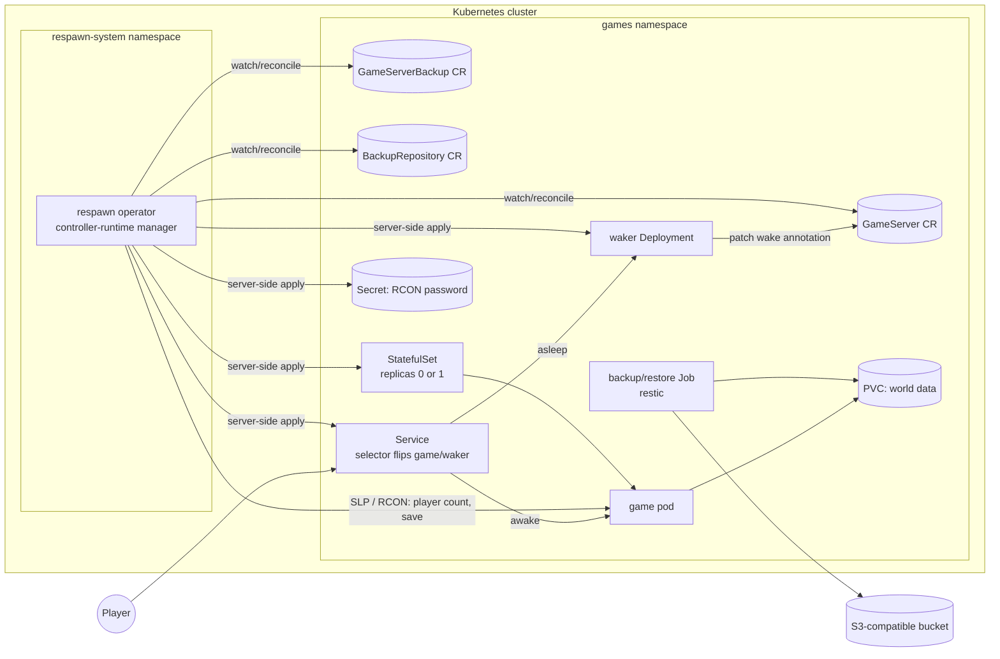
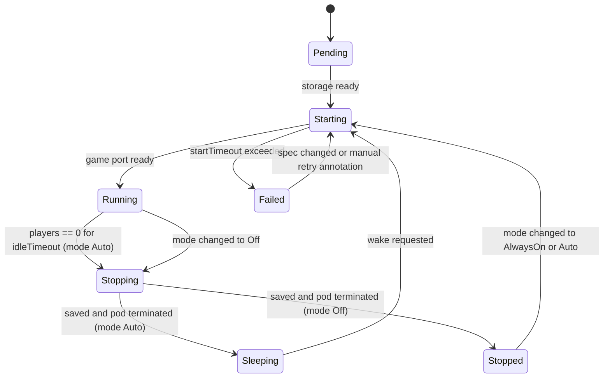

# respawn: project plan

| | |
| --- | --- |
| **Status** | Planned (design phase) |
| **Effort** | L |
| **Owner** | [@bblaker](https://github.com/bblaker) |
| **Stack** | Go, controller-runtime / Kubebuilder, CRDs, k3s, restic |
| **Last updated** | 2026-10-26 |

---

## Contents

1. [Summary](#1-summary)
2. [Goals, non-goals, success criteria](#2-goals-non-goals-success-criteria)
3. [Prior art](#3-prior-art)
4. [Architecture](#4-architecture)
5. [API design](#5-api-design)
6. [Testing strategy](#6-testing-strategy)
7. [Security](#7-security)
8. [Observability](#8-observability)
9. [Delivery: CI, releases, packaging](#9-delivery-ci-releases-packaging)
10. [Milestones](#10-milestones)
11. [Risks](#11-risks)
12. [Decision log](#12-decision-log)
13. [Open questions](#13-open-questions)
14. [Appendix: operator concepts map](#14-appendix-operator-concepts-map)

---

## 1. Summary

respawn is a Kubernetes operator for long-lived game servers. A user declares
a Minecraft or Factorio server as a `GameServer` custom resource. The operator
turns that into a running server with persistent storage, a stable network
endpoint, scheduled encrypted backups, and scale-to-zero: the server saves and
shuts down when nobody is online, and a lightweight waker starts it again when
a player tries to connect.

The project has two goals, in priority order:

1. **A public, production-quality operator** that shows the full set of
   platform-engineering skills: CRD design and versioning, an idempotent
   reconcile loop, owner references, finalizers, status conditions, RBAC,
   testing with envtest and real clusters, and a secure release pipeline.
2. **A useful tool.** A home or small-community game server that costs
   nothing while idle and never loses its world.

The first goal sets the bar for quality. The second keeps the scope honest.

## 2. Goals, non-goals, success criteria

### Goals

- **G1: Declarative servers.** One `GameServer` object fully describes a
  server. `kubectl apply` creates it, edits converge, and `kubectl delete`
  cleans up according to an explicit data policy.
- **G2: Persistence and data safety.** World data survives pod restarts, node
  reboots, operator upgrades, and accidental `GameServer` deletion (by
  default).
- **G3: Backups and restore.** Scheduled and on-demand backups to
  S3-compatible storage, consistent (taken while the game is not writing),
  encrypted, deduplicated, with retention. Restoring is one field on a new
  `GameServer`.
- **G4: Scale-to-zero.** Idle servers stop after a configurable timeout. A
  connection attempt wakes them. While asleep, the server list still shows the
  server, with a "sleeping" message.
- **G5: Multi-game through an adapter.** Minecraft and Factorio sit behind one
  Go interface, so adding a game does not touch the controller.
- **G6: Exemplary engineering.** High test coverage at every layer, a
  documented threat model, least-privilege RBAC, signed and attested releases.

### Non-goals (for v0.x)

- **Session-based or matchmade fleets.** That is
  [Agones](https://agones.dev/)'s job. respawn manages a few named,
  long-lived servers.
- **Horizontal scaling of one world.** Each `GameServer` is exactly one pod.
  Proxy networks such as Velocity or BungeeCord are out of scope.
- **Mod and plugin management** beyond passing through what the upstream
  image already supports (for example itzg's `MODRINTH_PROJECTS`).
- **A web UI.** `kubectl`, status conditions, events, and metrics are the
  interface.
- **Multi-cluster** setups, or moving servers between clusters.

### Success criteria for v0.1.0

| # | Criterion | How it is measured |
| --- | --- | --- |
| S1 | A Minecraft server goes from `kubectl apply` to joinable on a fresh k3s cluster | e2e test, plus a manual join with a real client |
| S2 | Idle server sleeps within `idleTimeout + pollInterval` and wakes on a login attempt | e2e test with a 30s timeout |
| S3 | Backup, then restore into a new `GameServer`, produces an identical world | e2e test comparing checksums of a marker file and `level.dat` |
| S4 | Killing the operator at any point during reconcile, backup, or sleep leaves no stuck or corrupt state | chaos e2e test |
| S5 | Factorio works through the same controller with no game-specific code outside its adapter | code review, plus e2e |
| S6 | ≥ 80% statement coverage on `internal/`, every network parser fuzzed | CI coverage gate, fuzz targets present |
| S7 | Release images signed, with SBOM and provenance, and no known High/Critical CVEs | CI release job, Trivy, govulncheck |
| S8 | A new user can follow the README to a running server in under 15 minutes | dry run by someone who isn't the author |

## 3. Prior art

| Project | What it does | How respawn differs |
| --- | --- | --- |
| [Agones](https://agones.dev/) | Fleets of session-based dedicated servers with allocation and matchmaking | Long-lived named servers with persistent worlds, backups, and scale-to-zero |
| [itzg/minecraft-server Helm chart](https://github.com/itzg/minecraft-server-charts) | Helm chart for one Minecraft server | Reconciled state, backups, sleep/wake, status, multiple games |
| [itzg/mc-router](https://github.com/itzg/mc-router) | Minecraft-aware reverse proxy that routes by hostname and can scale backends up on connect | respawn owns the whole lifecycle; mc-router may be a useful companion for hostname routing |
| [lazymc](https://github.com/timvisee/lazymc) | Process-level Minecraft sleep/wake proxy | Same idea in Kubernetes form; respawn's waker borrows the UX |
| [Shulker](https://github.com/jeremylvln/Shulker) | Operator for Minecraft proxy networks | Targets large networks; respawn targets small servers and many games |

respawn reuses the well-maintained upstream images (`itzg/minecraft-server`,
`factoriotools/factorio`) rather than building its own.

## 4. Architecture

### 4.1 Components



| Component | Binary / image | Responsibility |
| --- | --- | --- |
| **Operator** | `cmd/manager` → `ghcr.io/bblaker/respawn` | Reconciles all CRDs; polls player counts; orchestrates sleep, wake, backup, restore |
| **Waker** | `cmd/waker` → `ghcr.io/bblaker/respawn-waker` | Holds the game port while the server sleeps; answers status pings; requests a wake on a real join attempt |
| **Backup job** | upstream `restic` image, pinned by digest | Runs `restic backup`, `restore`, and `forget --prune` against the PVC |
| **Game pod** | upstream game image, pinned by digest | Runs the actual game |

### 4.2 Code layout

Standard Kubebuilder v4 layout:

```
api/v1alpha1/            CRD Go types, markers, CEL rules
cmd/manager/             operator entrypoint
cmd/waker/               waker entrypoint
internal/controller/     GameServer, GameServerBackup, BackupRepository reconcilers
internal/game/           Adapter interface + registry
internal/game/minecraft/ Minecraft adapter (env, ports, SLP, RCON commands)
internal/game/factorio/  Factorio adapter
internal/protocol/rcon/  Source RCON client (used by both games)
internal/protocol/mcping/ Minecraft Server List Ping client + server codec
internal/power/          idle/wake state machine (pure, clock-injected)
internal/backup/         restic Job builders, schedule and retention logic
internal/resources/      pure builders: desired StatefulSet/Service/etc. from spec
config/                  kustomize: CRDs, RBAC, manager, samples
charts/respawn/          Helm chart (M7)
test/e2e/                k3d-based end-to-end suite
docs/                    plan, guides, generated API reference
```

### 4.3 The game adapter interface

The controller only talks to this interface. Each game is one implementation.

```go
type Adapter interface {
    // Static description
    Name() string
    Ports(spec *v1alpha1.GameServer) []corev1.ContainerPort
    DataPath() string

    // Pod construction
    Container(spec *v1alpha1.GameServer, rconSecret string) corev1.Container
    ReadinessProbe(spec *v1alpha1.GameServer) *corev1.Probe

    // Runtime interaction (in-cluster, over the pod IP)
    PlayerCount(ctx context.Context, ep Endpoint) (int, error)
    Quiesce(ctx context.Context, ep Endpoint) error   // flush and pause world writes
    Resume(ctx context.Context, ep Endpoint) error    // re-enable writes
    Save(ctx context.Context, ep Endpoint) error      // flush before shutdown

    // Waker behavior
    WakerConfig(spec *v1alpha1.GameServer) waker.Config
}
```

| | Minecraft | Factorio |
| --- | --- | --- |
| Image | `itzg/minecraft-server` | `factoriotools/factorio` |
| Game port | TCP 25565 | UDP 34197 |
| RCON | TCP 25575 | TCP 27015 |
| PlayerCount | Server List Ping (no auth), RCON `list` as fallback | RCON `/players online count` |
| Quiesce / Resume | `save-off` + `save-all flush` / `save-on` | `/server-save` (saves are atomic zip files) / no-op |
| Wake trigger | Login Start packet (not status pings) | Well-formed connection request datagram |

### 4.4 Reconcile loop (GameServer)

Each pass is idempotent and level-triggered. It computes the full desired
state from the spec and current status, applies it with server-side apply
(field manager `respawn`), and returns.

1. **Fetch.** Get the `GameServer`. If it is gone, return.
2. **Finalizer.** If `deletionTimestamp` is set, run the deletion flow (4.7).
   Otherwise make sure `respawn.bblaker.com/finalizer` is present.
3. **Validate references.** Resolve `backup.repositoryRef` and Secrets. If
   they are missing, set `Ready=False, reason=ReferenceNotFound` and requeue.
   (Watches on these kinds re-trigger reconcile when they appear.)
4. **Secrets.** Make sure the RCON password Secret exists. It is generated
   once with `crypto/rand` and never rotated implicitly.
5. **Storage.** Make sure the PVC exists. On first creation with
   `restoreFrom`, run the restore Job and wait for it before step 6.
6. **Workload.** Apply the StatefulSet (replicas from the power state
   machine), the Service (selector from the power state), the waker
   Deployment and its RBAC, and the NetworkPolicy.
7. **Power.** Run the power state machine (4.5): poll players if Running,
   check for a wake request if Sleeping, check timeouts if Starting or
   Stopping.
8. **Backup schedule.** If a scheduled backup is due, create a
   `GameServerBackup` named after the schedule time, so a retried reconcile
   creates the same name and is a no-op.
9. **Status.** Compute conditions, phase, endpoint, and player count. Write
   status only if it changed.
10. **Requeue.** Return `RequeueAfter` = the earliest of: next player poll,
    idle deadline, next backup, start/stop timeout.

Rules every reconcile must follow:

- **State lives in the API, not in memory.** Timestamps such as
  `idleSince` and `lastWakeRequest` are in status, so an operator restart
  loses nothing.
- **No blocking.** RCON and ping calls have tight timeouts (2s). Anything
  long-running is a Job or a requeue.
- **Minimal writes.** Status is written on transitions, not on every poll.
  The player count is written only when it changes.
- **Owner references** on everything except a `Retain` PVC, so garbage
  collection cleans up.
- **Watches:** `Owns(StatefulSet, Service, Deployment, Job, Secret)`, plus
  `Watches(BackupRepository)` through a field index for referencing servers.

### 4.5 Power state machine



- **Idle detection.** While Running, the operator polls `PlayerCount` every
  `pollInterval` (default 30s). The first poll that sees 0 players sets
  `status.idleSince`. Any poll that sees players clears it. When
  `now - idleSince >= idleTimeout` the server moves to Stopping.
- **Grace after start.** `idleTimeout` is measured from the later of
  `idleSince` and the time the server became Ready, so a woken server is not
  put straight back to sleep before the player who woke it can join.
- **Poll failures** do not count as zero players. Three consecutive failures
  set `Degraded=True, reason=PlayerCountUnavailable` and pause idle
  detection. Failing safe means staying on.
- **Stopping.** Call `Save`, then scale the StatefulSet to 0. The pod's
  `terminationGracePeriodSeconds` (default 120s) lets the image do its own
  clean shutdown.
- **Wake.** The waker writes the annotation
  `respawn.bblaker.com/wake-requested-at: <RFC3339>`. If that is newer than
  `status.lastWakeTime`, the operator moves to Starting and records
  `lastWakeTime`. Repeat requests within `wakeCooldown` are ignored.
- **Backup lock.** If a backup Job is mounting the PVC while the server
  sleeps, the wake is deferred until the Job finishes, up to a bounded
  timeout. Status shows `reason=WaitingForBackup`.

### 4.6 Waker

A small Go binary (one per `GameServer`, about 10 MiB RSS) that is always
running. The operator flips the game Service's selector between the game pod
and the waker pod, so traffic switches within seconds in both directions with
no cold start for the waker.

- **Minecraft:** implements just enough of the protocol: Handshake, Status
  (returns a configurable MOTD, such as "Sleeping. Join to start (~60s)",
  with the real version and max players), Ping, and Login Start. A **status
  ping never wakes the server**, because server lists refresh constantly. A
  Login Start triggers the wake and disconnects the client with "Starting
  server, try again in about a minute."
- **Factorio:** listens on UDP. Only a datagram that parses as a valid
  connection request triggers a wake; anything else is dropped.
- **Defensive by default:** strict packet length limits, read deadlines,
  connection caps, per-IP and global rate limits on wake requests, and no
  allocation proportional to attacker-controlled lengths.
- **Permissions:** its ServiceAccount has a Role that can only `get` and
  `patch` its own `GameServer`, enforced with `resourceNames`.

### 4.7 Deletion and finalizers

On `GameServer` deletion:

1. If `backup.onDelete: true` and a repository is configured, create and
   wait for a final `GameServerBackup`. A failure here blocks deletion and
   is surfaced as `reason=FinalBackupFailed`. The user can override with
   annotation `respawn.bblaker.com/skip-final-backup: "true"`.
2. Scale to 0 after a `Save`.
3. Apply `storage.reclaimPolicy`. `Retain` (the default) removes the owner
   reference and labels the PVC `respawn.bblaker.com/orphaned-from=<name>`.
   `Delete` deletes it.
4. Remove the finalizer. Owned objects are garbage-collected.

On `GameServerBackup` deletion with `deletionPolicy: Delete`, a Job runs
`restic forget <snapshotID>` before the finalizer is removed. `Retain` keeps
the snapshot.

### 4.8 Backups and restore

- **Engine: restic.** Client-side encryption, content-defined deduplication
  (Minecraft worlds are large but change slowly), integrity checks, and
  built-in retention. Each server uses its own repository path
  (`<prefix>/<namespace>/<name>`) so prune locks never contend between
  servers.
- **Consistency.** If the server is Running, the controller calls `Quiesce`,
  records `status.quiesced=true` on the `GameServerBackup`, runs the Job, then
  calls `Resume`. If the operator crashes in between, the next reconcile sees
  `quiesced=true` and resumes. A maximum quiesce duration (default 10m) is
  enforced regardless of what the Job is doing. If the server is
  Sleeping or Stopped, data is already at rest and the Job mounts the PVC
  directly.
- **ReadWriteOnce volumes.** k3s's default `local-path` volumes are
  node-local and ReadWriteOnce. The backup Job uses node affinity to land on
  the same node as the game pod and mounts the PVC read-only. This works for
  RWO (which is per-node), but not for `ReadWriteOncePod`, which is rejected by
  CEL validation when backups are enabled.
- **Schedule.** A standard 5-field cron in `backup.schedule`, parsed with
  `robfig/cron`. The operator creates `GameServerBackup` objects itself
  rather than using a CronJob, because it has to coordinate quiescing.
  Missed schedules (operator down) produce at most one catch-up backup.
- **Retention.** `keepLast`, `keepDaily`, `keepWeekly`, `keepMonthly` map to
  `restic forget --prune`. That runs after each successful scheduled backup,
  at most once a day.
- **Restore.** `spec.storage.restoreFrom.backupName` (or `snapshotID` and
  `repositoryRef`) is honored **only when the PVC is first created**. The
  field is immutable afterwards (CEL), which rules out accidentally
  overwriting a live world. In-place restore of an existing server is
  documented as: create a new `GameServer` from the backup, then delete the
  old one.
- **Optional extras:** `backup.beforeSleep: true` takes a backup on every
  idle shutdown (throttled by `minInterval`).

## 5. API design

API group `respawn.bblaker.com`, version `v1alpha1`. All kinds are
namespaced. All references are to objects in the same namespace.

### 5.1 `GameServer`

```yaml
apiVersion: respawn.bblaker.com/v1alpha1
kind: GameServer
metadata:
  name: survival
spec:
  # Exactly one game block (CEL: exactly one of minecraft/factorio set; game is immutable)
  minecraft:
    eula: true                 # required true; never defaulted
    version: "1.21.4"
    type: PAPER                # VANILLA | PAPER | FABRIC | FORGE | ...
    memory: 4Gi                # JVM heap; container limit = memory + overhead
    motd: "Survival"
    env: {}                    # pass-through to itzg image, allowlisted keys only
  # factorio:
  #   version: "2.0"
  #   saveName: world
  #   serverSettingsRef: { name: factorio-settings }   # ConfigMap

  image: ""                    # optional override; default is pinned per adapter
  storage:
    size: 20Gi
    storageClassName: local-path
    reclaimPolicy: Retain      # Retain | Delete
    restoreFrom:               # optional, create-time only
      backupName: survival-20261020-0400
  power:
    mode: Auto                 # AlwaysOn | Auto | Off
    idleTimeout: 15m
    pollInterval: 30s
    startTimeout: 10m
    wakeCooldown: 60s
    sleepingMotd: "Sleeping. Join to start (~60s)"
  backup:
    repositoryRef: { name: b2-backups }
    schedule: "0 4 * * *"
    retention: { keepLast: 3, keepDaily: 7, keepWeekly: 4 }
    beforeSleep: false
    onDelete: true
  service:                     # one Service (endpoint) per server, see D12
    type: LoadBalancer         # LoadBalancer | NodePort | ClusterIP
    port: 25565                # external port; defaults to the game's port. Must be
                               # unique per node when using k3s ServiceLB
    annotations: {}            # e.g. metallb.universe.tf/loadBalancerIPs for a fixed IP
  pod:                         # constrained scheduling overrides, not a full PodTemplate
    nodeSelector: {}
    tolerations: []
    affinity: {}
    resources: {}              # CPU; memory derived from game block unless set
status:
  observedGeneration: 4
  phase: Running               # Pending | Starting | Running | Stopping | Sleeping | Stopped | Failed
  playersOnline: 2
  maxPlayers: 20
  endpoint: 192.168.1.40:25565
  idleSince: null
  lastWakeTime: "2026-10-26T18:02:11Z"
  readySince: "2026-10-26T18:03:05Z"
  lastBackup: { name: survival-20261026-0400, time: "...", snapshotID: "a1b2c3d4" }
  nextBackupTime: "2026-10-27T04:00:00Z"
  conditions: [...]
```

**Conditions** (standard `metav1.Condition`, with `observedGeneration`):

| Type | True means | Example reasons when not healthy |
| --- | --- | --- |
| `Ready` | Players can join right now | `Starting`, `Sleeping`, `Stopped`, `ReferenceNotFound`, `StartTimeout` |
| `Available` | A join attempt will succeed or wake the server | `WakerUnavailable`, `Stopped` |
| `Progressing` | A transition is under way (start, stop, restore, rollout) | |
| `Degraded` | Something needs attention but the server works | `PlayerCountUnavailable`, `BackupFailing`, `QuiesceStuck` |
| `BackupHealthy` | Last scheduled backup succeeded within 2× its interval | `LastBackupFailed`, `RepositoryUnreachable` |

**Printer columns:** Game, State (phase), Players, Endpoint, Age.

**Validation (CEL `x-kubernetes-validations`, no admission webhook in v1alpha1):**

- exactly one game block is set, and the game kind is immutable
- `minecraft.eula == true`
- `storage.storageClassName` and `storage.restoreFrom` are immutable;
  `storage.size` may only grow
- `idleTimeout >= 2 * pollInterval`; durations within sane bounds
- `backup.schedule` is a valid 5-field cron (regex-level check, full parse
  reported as a condition)
- `minecraft.env` keys are on an allowlist (no overriding RCON or EULA
  variables)

### 5.2 `GameServerBackup`

```yaml
apiVersion: respawn.bblaker.com/v1alpha1
kind: GameServerBackup
metadata:
  name: survival-manual-1
spec:
  gameServerName: survival
  deletionPolicy: Retain       # Retain | Delete (forget the snapshot)
status:
  phase: Succeeded             # Pending | Quiescing | Running | Succeeded | Failed
  quiesced: false
  snapshotID: a1b2c3d4
  startTime: ...
  completionTime: ...
  sizeBytes: 812345678
  addedBytes: 1234567
  conditions: [...]
```

Spec is immutable after creation. Scheduled backups get the label
`respawn.bblaker.com/scheduled: "true"` and an owner reference to their
`GameServer` (manual ones do not, so they outlive the server).

### 5.3 `BackupRepository`

```yaml
apiVersion: respawn.bblaker.com/v1alpha1
kind: BackupRepository
metadata:
  name: b2-backups
spec:
  s3:
    endpoint: https://s3.us-west-004.backblazeb2.com
    bucket: my-respawn-backups
    prefix: home-cluster
    region: us-west-004
  credentialsSecretRef: { name: b2-credentials }      # AWS_ACCESS_KEY_ID / AWS_SECRET_ACCESS_KEY
  encryptionSecretRef: { name: restic-password }      # RESTIC_PASSWORD
status:
  conditions: [ { type: Ready, ... } ]                # set by a periodic connectivity check Job
```

### 5.4 API evolution

- `v1alpha1`: anything may change, with notes in the changelog.
- `v1beta1` (post-0.1): introduced with a conversion webhook (cert-manager
  or controller-runtime's built-in cert rotation) and round-trip fuzz tests
  for conversion. `v1alpha1` is served for at least one minor release
  afterwards.
- Field names follow the
  [Kubernetes API conventions](https://github.com/kubernetes/community/blob/master/contributors/devel/sig-architecture/api-conventions.md).
  Generated API reference docs come from
  [crd-ref-docs](https://github.com/elastic/crd-ref-docs).

## 6. Testing strategy

Testing follows a pyramid: lots of fast, pure unit tests; envtest for
controller behavior against a real API server; a smaller e2e suite on real
k3s for what only a real cluster can show.

### 6.1 Layers

| Layer | Tooling | Scope | Runs |
| --- | --- | --- | --- |
| **Unit** | `go test`, table-driven, `-race` | resource builders, power state machine, cron and retention math, CEL-equivalent validation helpers, adapter env/port mapping | every push, < 30s |
| **Protocol** | unit tests with golden byte fixtures, plus **Go native fuzzing** | `mcping` codec (both client and waker server side), RCON client, Factorio datagram parser | every push (short fuzz); nightly (10 min per target) |
| **Controller integration** | **envtest** (real kube-apiserver + etcd, no kubelet), Ginkgo/Gomega | reconcile creates the right objects; status conditions; finalizers; owner refs; CEL validation accepts and rejects; idempotency; watches trigger reconcile | every push, ~2 min |
| **End-to-end** | **k3d** (k3s in Docker), Ginkgo, real game images, in-cluster MinIO | full lifecycle per game (see 6.3) | PR: smoke subset; nightly: full matrix |
| **Chaos / resilience** | e2e plus fault injection | operator killed mid-transition; game pod deleted; node restart; S3 unreachable; backup Job OOM | nightly |
| **Upgrade** | e2e | install previous release with running servers, upgrade operator, assert no game pod restarts and no spec drift | before each release |
| **Manual acceptance** | checklist in release issue | join with real Minecraft and Factorio clients; sleep/wake UX; on a Raspberry Pi (arm64) k3s node | before each release |

### 6.2 Testability by design

- **Pure builders.** `internal/resources` turns `(GameServer, adapter)` into
  desired objects with no API calls, so most logic is tested as
  input-to-output tables and golden YAML.
- **Injected clock.** The power state machine and backup scheduler take a
  `clock.Clock` (`k8s.io/utils/clock/testing`), so idle timeouts and cron
  schedules are tested without sleeping.
- **Fake adapter.** A `fakegame` adapter with scriptable `PlayerCount`,
  `Save`, and `Quiesce` results (including errors and hangs) drives envtest
  scenarios, since envtest has no kubelet and pods never actually run.
- **Fake Job outcomes.** envtest tests set Job status directly to simulate
  backup success or failure.
- **Idempotency check.** A shared helper runs reconcile twice and asserts
  that the second pass makes zero write calls, using an instrumented client
  wrapper.

### 6.3 E2E scenarios

1. **Minecraft lifecycle:** apply → Ready → SLP ping returns the expected
   MOTD → set a marker block via RCON → delete pod → comes back with the
   marker intact.
2. **Sleep and wake:** `idleTimeout: 30s` → Sleeping, StatefulSet at 0,
   Service selector on the waker → status ping shows the sleeping MOTD and
   does **not** wake → Login Start wakes → Ready.
3. **Backup and restore:** MinIO-backed `BackupRepository` → manual backup
   while Running (asserts quiesce and resume) → backup while Sleeping →
   restore into a new `GameServer` → marker and `level.dat` checksum match.
4. **Retention:** with a fake schedule, assert snapshots are pruned per policy.
5. **Deletion:** `Retain` leaves an orphan-labeled PVC; `Delete` removes it;
   `onDelete` backup appears in the repository.
6. **Factorio:** apply → Ready → RCON player count → sleep → UDP wake → save
   survives restart.
7. **Security posture:** pods pass Pod Security Admission `restricted` in an
   enforcing namespace (game pods: documented exceptions only);
   NetworkPolicy blocks RCON from a test pod in another namespace; waker
   cannot patch a different `GameServer`.

E2E runs on k3s specifically (not kind), because k3s is the target: its
ServiceLB, local-path provisioner, and embedded network policy controller all
behave differently from the alternatives. Game images are pre-pulled and
cached in CI; the Minecraft server jar is cached through a mounted volume to
keep runs under about 15 minutes.

### 6.4 Quality gates in CI

- `gofmt`, `go vet`, `golangci-lint` (including `gosec`, `errcheck`,
  `staticcheck`, `revive`)
- `make generate manifests && git diff --exit-code` so generated code and CRDs
  are never stale
- unit + envtest with `-race` and a coverage threshold of **80% on
  `internal/`**, with generated code excluded
- short fuzz run (30s per target) on PRs that touch `internal/protocol/` or
  `cmd/waker/`
- `kubeconform` and `kube-linter` on rendered manifests and the Helm chart
- e2e smoke on PRs labeled `e2e` or touching `internal/controller/`; full
  suite nightly against the three most recent k3s minor versions

## 7. Security

### 7.1 Assets

| Asset | Why it matters |
| --- | --- |
| World data (PVC, backups) | Irreplaceable to users; the main thing to protect |
| Backup credentials and restic password | Access to all historical worlds; the restic password cannot be recovered |
| RCON passwords | RCON gives full operator control of the game server |
| Kubernetes API access of the operator | Cluster-wide write access to several resource kinds |
| Release artifacts | Compromised images would run in users' clusters |

### 7.2 Threat model

| # | Threat | Component | Mitigation |
| --- | --- | --- | --- |
| T1 | Malformed or hostile packets crash or exploit the waker | waker (internet-facing) | Strict length limits and read deadlines, no attacker-sized allocations, fuzz tests, memory-safe Go, distroless non-root, read-only root filesystem, resource limits |
| T2 | Wake flooding keeps a server permanently awake (cost or annoyance) | waker | Status pings never wake; only full login or connection-request packets; per-IP and global wake rate limits; `wakeCooldown` |
| T3 | Compromised waker escalates in the cluster | waker SA | Role scoped to `get`/`patch` on its own `GameServer` via `resourceNames`; no Secret access; can only set the wake annotation (the operator ignores other changes from that field manager) |
| T4 | RCON reached by attackers | game pod | RCON port never on the Service; NetworkPolicy allows RCON only from the operator and backup Jobs; random 32-byte password per server |
| T5 | Secrets leak via logs, events, status, or `kubectl describe` | operator | Secrets only by reference; a log-scrubbing helper; a lint rule against logging secret values; tests that assert events and status contain no secret material |
| T6 | Tenant with `GameServer` create rights reads other namespaces' Secrets | operator | Same-namespace references only; operator never copies Secrets across namespaces; documented as a confused-deputy boundary |
| T7 | Tenant escalates through pod spec fields (hostPath, privileged, arbitrary image) | operator | No raw PodTemplate; a narrow `pod` override block; `env` allowlist; `image` override can be disabled cluster-wide by an operator flag; restricted security context defaults |
| T8 | Operator over-privileged | operator RBAC | RBAC generated from Kubebuilder markers and reviewed in PRs; no `*` verbs; no cluster-wide Secret list/watch when running in namespaced mode; optional single-namespace mode |
| T9 | Backup tampering or theft from the bucket | backups | restic client-side encryption (AES-256, authenticated); credentials scoped to one bucket and prefix; recommend bucket object lock or versioning |
| T10 | Supply-chain compromise (dependency, action, base image) | build | Pinned Go modules with `go.sum`; GitHub Actions pinned by SHA; Dependabot; govulncheck; distroless base pinned by digest; upstream images pinned by digest |
| T11 | Tampered release images | release | cosign keyless signing via GitHub OIDC; SLSA provenance and SBOM attestations; verification command documented in the README |
| T12 | Data loss from operator bugs (deleting PVCs, restoring over live data) | operator | `reclaimPolicy: Retain` default; `restoreFrom` create-time only and immutable; finalizer blocks on failed final backup; chaos tests (S4) |

### 7.3 Workload hardening defaults

| Setting | Operator and waker | Backup Jobs | Game pods |
| --- | --- | --- | --- |
| `runAsNonRoot` | yes (65532) | yes | yes (uid 1000, supported by both images) |
| `readOnlyRootFilesystem` | yes | yes | no: the images write outside `/data` (documented exception) |
| `allowPrivilegeEscalation` | false | false | false |
| `capabilities` | drop ALL | drop ALL | drop ALL |
| `seccompProfile` | RuntimeDefault | RuntimeDefault | RuntimeDefault |
| `automountServiceAccountToken` | operator and waker only | false | false |
| Resource limits | yes | yes | yes |

NetworkPolicies are generated per server: game port open from anywhere (it
is a public server), RCON only from the operator namespace and backup Jobs,
and backup Job egress only to DNS and the repository endpoint. k3s ships an
embedded network policy controller, so these are enforced out of the box.

### 7.4 Secure development lifecycle

- **CI security tooling:** CodeQL (Go), `gosec` through golangci-lint,
  `govulncheck`, Trivy image scan (fail on fixable High/Critical), gitleaks
  secret scanning, OpenSSF Scorecard.
- **Repository settings:** branch protection on `main` (required checks,
  required review, no force-push), private vulnerability reporting enabled,
  Dependabot security updates enabled, least-privilege `permissions:` in every
  workflow (default `contents: read`).
- **Release integrity:** reproducible builds with `ko`; images signed with
  cosign; SBOM (SPDX) and SLSA provenance attached as attestations.
- **Reviews:** a written threat-model review at M4 (waker exposure) and M7
  (pre-release), recorded in `docs/security/`.
- **Policy:** [SECURITY.md](../SECURITY.md) covers disclosure, response
  targets, and scope.
- **Docs deploy credentials:** the Cloudflare Pages token is scoped to Pages
  only, is stored in a protected environment, and is never exposed to
  workflows triggered by forks (9.5).

### 7.5 Legal and licensing

- Minecraft requires the operator of a server to accept the
  [Minecraft EULA](https://www.minecraft.net/eula). respawn never defaults
  `eula: true`; users must set it themselves.
- respawn does not redistribute game binaries; the upstream images download
  them at runtime under their own terms.
- Project license: Apache-2.0 (confirmed).

## 8. Observability

- **Metrics** (Prometheus, through the controller-runtime metrics endpoint,
  protected by `authn/authz` filters):
  - `respawn_gameserver_phase{namespace,name,game,phase}` (gauge 0/1)
  - `respawn_gameserver_players_online{namespace,name,game}`
  - `respawn_gameserver_idle_shutdowns_total`, `respawn_gameserver_wakes_total{trigger}`
  - `respawn_gameserver_wake_duration_seconds` (histogram: wake request to Ready)
  - `respawn_backup_last_success_timestamp_seconds`, `respawn_backup_duration_seconds`, `respawn_backup_failures_total`
  - `respawn_waker_connections_total{kind}`, `respawn_waker_rejected_total{reason}`
  - plus the controller-runtime defaults (reconcile duration, errors, workqueue depth)
- **Events** on every state transition, backup result, and validation
  failure.
- **Structured logs** (zap/logr JSON) with `gameserver` and `reconcileID`
  keys; debug level shows each state machine decision.
- **Deliverables:** a Grafana dashboard JSON and example PrometheusRule
  alerts (backup stale, server stuck in Starting, degraded > 15m) in
  `config/monitoring/`.

## 9. Delivery: CI, releases, packaging

### 9.1 CI (GitHub Actions)

| Workflow | Trigger | Jobs |
| --- | --- | --- |
| `ci.yml` | push, PR | lint · generate-check · unit+envtest (coverage) · build (amd64, arm64) · short fuzz · kubeconform |
| `e2e.yml` | PR with label or controller changes; nightly | k3d cluster · deploy · Ginkgo e2e · upload artifacts (logs, `kubectl get -A -o yaml`) on failure |
| `security.yml` | push, PR, weekly | CodeQL · govulncheck · Trivy · gitleaks · Scorecard |
| `fuzz-nightly.yml` | nightly | 10 min per fuzz target; new crashers opened as issues |
| `release.yml` | tag `v*` | ko build multi-arch · cosign sign · SBOM and provenance attest · Helm chart to OCI · `install.yaml` and CRDs as release assets · GitHub release from changelog |
| `docs.yml` (M7) | push to `main`, PR touching `docs/` or `api/` | MkDocs build (strict, link check) · generate API reference · deploy to Cloudflare Pages (preview on PR, production on `main`) |

### 9.2 Versioning and releases

- Semantic versioning of the operator; the API version (`v1alpha1`) evolves
  separately.
- Supported Kubernetes: the three most recent k3s minor releases, tested
  nightly. Other conformant distributions are best effort.
- Architectures: `linux/amd64` and `linux/arm64` (Raspberry Pi homelabs are a
  core audience).
- Release checklist issue template: changelog, upgrade e2e, manual
  acceptance, docs, threat model delta.

### 9.3 Install methods

1. `kubectl apply -f https://github.com/bblaker/respawn/releases/download/vX.Y.Z/install.yaml`
2. Helm: `helm install respawn oci://ghcr.io/bblaker/charts/respawn`
3. Later: Artifact Hub listing; possibly OperatorHub (OLM bundle).

### 9.4 Developer experience

- `make dev-cluster` creates a k3d cluster with a local registry and MinIO.
- `make deploy` builds with `ko` straight into the k3d registry.
- `make run` runs the operator locally. Player polling needs pod network
  access, so `--dev-port-forward` mode tunnels to pods; otherwise use
  `make deploy`.
- Sample manifests in `config/samples/` for every kind and game.

### 9.5 Documentation

- **Until M7:** Markdown in `docs/` is the only form of the docs, readable on
  GitHub.
- **From M7:** the same Markdown is built with
  [MkDocs Material](https://squidfunk.github.io/mkdocs-material/) and
  published to **Cloudflare Pages**. The API reference is generated by
  crd-ref-docs during the build, so it cannot drift from the CRDs.
- **Deployment:** a `docs.yml` workflow builds the site and deploys it with
  `cloudflare/wrangler-action`. The API token is scoped to Cloudflare Pages
  edit on that single account. It lives in a protected `docs` GitHub
  environment that only `main` can deploy from. Pull requests from branches in
  this repository get preview deploys. Pull requests from forks build but never
  receive the token.
- **URL:** the default `*.pages.dev` address, with a custom domain on
  `bblaker.com` optional.

## 10. Milestones

Sizes are relative (S ≈ a few sessions, M ≈ one to two weeks part-time,
L ≈ several weeks). Each milestone ends with a demo-able result and its exit
criteria passing in CI.

### M0: Foundations (S) (this change)

- [x] Repository health files: README, LICENSE, CONTRIBUTING, SECURITY,
      CODE_OF_CONDUCT, CHANGELOG, issue and PR templates, CODEOWNERS,
      Dependabot, editorconfig, gitattributes
- [x] Project plan
- [ ] Repository settings: branch protection, private vulnerability
      reporting, Dependabot alerts, Actions permissions read-only by default

**Exit:** plan reviewed; repository settings applied.

### M1: Scaffold and CI (S)

- [ ] `kubebuilder init --domain bblaker.com --repo github.com/bblaker/respawn`
- [ ] `kubebuilder create api` for `GameServer`, `GameServerBackup`,
      `BackupRepository` (types only, empty reconcilers)
- [ ] Makefile targets from CONTRIBUTING; tools pinned into `./bin`
- [ ] `ci.yml` and `security.yml`; golangci-lint config; coverage reporting
- [ ] k3d dev cluster target; `ko` build; distroless images
- [ ] `docs/adr/` with the decisions in section 12 written up

**Exit:** `make lint test` green in CI; operator deploys to k3d and logs
"started".

### M2: GameServer core: Minecraft, AlwaysOn (M)

- [ ] Game adapter interface and Minecraft adapter
- [ ] Builders: StatefulSet, Service, PVC, RCON Secret, NetworkPolicy
- [ ] Reconcile loop with server-side apply, owner refs, finalizer,
      `reclaimPolicy`
- [ ] Conditions `Ready`, `Progressing`, `Degraded`; printer columns; events
- [ ] CEL validation rules plus envtest tests for each rule
- [ ] envtest suite: create, update, delete, idempotency, missing references
- [ ] e2e scenario 1 (Minecraft lifecycle)

**Exit:** S1 met; e2e scenario 1 green.

### M3: Player detection and sleep (M)

- [ ] `internal/protocol/mcping` client and `internal/protocol/rcon` client,
      with golden tests and fuzz targets
- [ ] `internal/power` state machine with an injected clock and exhaustive
      transition tests
- [ ] Idle polling, `idleSince` bookkeeping, graceful save, scale to 0
- [ ] Poll failure handling (fail safe: stay on)
- [ ] Metrics: phase, players, idle shutdowns

**Exit:** a server with `mode: Auto` sleeps after idle in e2e. It cannot wake
yet; `mode: AlwaysOn` brings it back.

### M4: Waker (M)

- [ ] `cmd/waker`: Minecraft Handshake, Status, Ping, Login Start; sleeping
      MOTD; disconnect message
- [ ] Rate limiting, connection caps, deadlines; fuzzing of the server-side
      codec
- [ ] Per-server waker Deployment, ServiceAccount, and `resourceNames`-scoped
      Role
- [ ] Service selector flip; wake annotation handling; `wakeCooldown`; grace
      period after start
- [ ] `Available` condition; wake metrics
- [ ] Threat model review for the internet-facing surface
      (`docs/security/waker.md`)

**Exit:** S2 met; e2e scenarios 2 and 7 (waker RBAC part) green.

### M5: Backups and restore (L)

- [ ] `BackupRepository` reconciler with a connectivity-check Job and `Ready`
      condition
- [ ] `GameServerBackup` reconciler: quiesce, Job with node affinity,
      resume, crash recovery through `status.quiesced`
- [ ] Scheduling with deterministic names; catch-up policy; `nextBackupTime`
- [ ] Retention and prune; `deletionPolicy` finalizer
- [ ] `restoreFrom` at PVC creation; immutability rules
- [ ] `backup.onDelete` and `beforeSleep`; backup lock that defers wake
- [ ] `BackupHealthy` condition; backup metrics; example alerts
- [ ] MinIO in the dev cluster and e2e

**Exit:** S3 met; e2e scenarios 3, 4, 5 green.

### M6: Factorio (M)

- [ ] Factorio adapter: ports, env, RCON player count, save
- [ ] Waker UDP mode with connection request parsing and fuzzing
- [ ] Settings via ConfigMap reference
- [ ] Refactor anything Minecraft-specific that leaked into the controller
- Not in scope: mods ([D13](#12-decision-log))

**Exit:** S5 met; e2e scenario 6 green.

### M7: Hardening and v0.1.0 (M)

- [ ] Chaos and upgrade e2e suites (S4)
- [ ] Helm chart with values schema; `install.yaml`; namespaced-mode flag
- [ ] `release.yml`: multi-arch ko builds, cosign, SBOM, provenance, OCI chart
- [ ] Generated API reference; getting-started guide; backup and restore
      guide; troubleshooting guide; networking guide (ServiceLB ports vs.
      MetalLB or kube-vip IPs)
- [ ] Docs site: MkDocs Material, `docs.yml`, Cloudflare Pages project, PR
      previews (9.5)
- [ ] Grafana dashboard
- [ ] Pre-release security review; Scorecard score ≥ 7
- [ ] Manual acceptance on amd64 and arm64 k3s; fresh-user walkthrough (S8)

**Exit:** all success criteria S1–S8 met; `v0.1.0` tagged; write-up
published on bblaker.com.

### Later (post-0.1, unordered)

- `v1beta1` with a conversion webhook
- CSI VolumeSnapshot backups as an alternative to restic, for storage
  classes that support them
- More games: Valheim, Terraria, Satisfactory
- Notifications (Discord webhook) on wake, sleep, and backup failure
- Hostname-based routing for many Minecraft servers on one IP and port,
  possibly by integrating mc-router (deferred by D12)
- Factorio mod support with a factorio.com token Secret (deferred by D13)
- In-place restore with an explicit, confirmation-gated workflow
- Pre-warming (scheduled wake before a regular play session)

## 11. Risks

| Risk | Likelihood | Impact | Mitigation |
| --- | --- | --- | --- |
| Wake latency (Minecraft boot ≈ 30–90s) makes the experience feel broken | High | Medium | Clear sleeping MOTD and disconnect message; measure `wake_duration`; document tuning (Paper, pre-generated worlds); optional pre-warming |
| Backup corrupts or misses data during writes | Medium | High | Quiesce protocol, crash-safe resume, restore verified by checksum in e2e, recommend `beforeSleep` backups |
| Operator bug deletes or overwrites a world | Low | Critical | `Retain` default, create-time-only restore, finalizer guards, chaos tests, extra review on any code path that deletes |
| Factorio UDP wake detection is unreliable across client versions | Medium | Medium | Capture real client datagrams as fixtures; fall back to "any datagram from a new source after cooldown" as an opt-in mode |
| Upstream images change env vars or behavior | Medium | Medium | Pin by digest; Dependabot or Renovate bumps run the full e2e suite; adapter integration tests per image version |
| `local-path` RWO volumes make node failure a hard stop | Medium | Medium | Document it; backups make recovery possible; supported path for Longhorn or other replicated storage classes |
| Scope creep (more games, UI, mods) | High | Medium | Non-goals section; anything new goes to "Later" until v0.1.0 ships |
| Single maintainer | High | Medium | Good docs, ADRs, and tests so the project is easy to pick up; small milestones that each ship something |

## 12. Decision log

These become full ADRs in `docs/adr/` during M1.

| # | Decision | Alternatives | Why |
| --- | --- | --- | --- |
| D1 | One `GameServer` kind with a per-game union block | One kind per game (`MinecraftServer`, `FactorioServer`) | One controller, one set of conditions and tooling; the adapter interface keeps game logic separate; CEL enforces the union |
| D2 | StatefulSet with replicas 0 or 1 and an operator-managed PVC | Deployment with `Recreate`; StatefulSet `volumeClaimTemplates` | StatefulSet gives at-most-one-pod semantics (no two pods writing a world); a separately managed PVC gives full control over the reclaim policy |
| D3 | CEL validation, no admission webhooks in v1alpha1 | Validating and defaulting webhooks | No cert-manager dependency and no webhook availability risk; CEL covers the needed rules, including transition rules |
| D4 | restic for backups | tar + upload; CSI snapshots; Velero | Encryption, deduplication, retention, and integrity in one well-audited tool; works on `local-path`; CSI snapshots planned as an option later |
| D5 | Per-server waker plus Service selector flip | Shared gateway proxy always in the data path | No extra hop or latency for awake servers; a waker failure cannot affect a running server; per-server RBAC is simpler |
| D6 | Operator polls players directly | Sidecar exporter; parsing game logs | No changes to upstream images; state transitions stay in one place; polling cost is trivial at this scale |
| D7 | The operator creates backups on schedule instead of using a CronJob | Kubernetes CronJob | Backups need quiesce and resume coordination with the live server, which a CronJob cannot do |
| D8 | Server-side apply for owned objects | Get, mutate, update | Correct field ownership, fewer conflicts, cleaner idempotency |
| D9 | `ko` for images | Dockerfile + buildx | Fast reproducible multi-arch Go builds on distroless, with SBOMs built in |
| D10 | Apache-2.0 license | MIT; MPL-2.0 | The Kubernetes ecosystem norm; explicit patent grant |
| D11 | API group `respawn.bblaker.com` | A neutral domain; `*.io` vanity domain | Conventional (a domain the author controls); changing it later is a breaking change, so it is fixed from M2 |
| D12 | One endpoint (Service) per server; no hostname routing in v0.1 | Shared port with Minecraft hostname routing (mc-router) | Keeps the waker and selector flip simple, and works for Factorio (UDP has no hostname). With k3s ServiceLB, servers share node IPs and need distinct ports (`service.port`); distinct IPs need MetalLB or kube-vip. Both are documented |
| D13 | Factorio mods deferred past v0.1 | Mod support in M6 | Needs a factorio.com token (another secret to handle); M6 is about proving the adapter interface with a plain server |
| D14 | Docs as Markdown in the repository; published site on Cloudflare Pages at M7 | GitHub Pages; repository Markdown only | Markdown stays the source of truth; Cloudflare Pages adds a preview deploy for every PR, which GitHub Pages lacks (9.5) |

## 13. Open questions

None open. All questions from the initial plan were resolved on 2026-10-26:

| Question | Resolution |
| --- | --- |
| License | Apache-2.0 ([D10](#12-decision-log)) |
| API group | `respawn.bblaker.com` ([D11](#12-decision-log)) |
| Hostname routing vs. one IP per server | One endpoint per server for v0.1; hostname routing is in "Later" ([D12](#12-decision-log)) |
| Factorio mods | Deferred past v0.1 ([D13](#12-decision-log)) |
| Docs site | Markdown in the repository until M7, then published on Cloudflare Pages ([D14](#12-decision-log)) |

New questions get added here as they come up.

## 14. Appendix: operator concepts map

Where each concept the project is meant to demonstrate shows up:

| Concept | Where |
| --- | --- |
| CRD design, printer columns, subresources | `api/v1alpha1`: three kinds, `status` subresource, columns (M2) |
| CEL validation and transition rules | immutability, union, size-only-grows (M2) |
| Level-triggered, idempotent reconcile | GameServer reconciler; zero-write second pass test (M2) |
| Owner references and garbage collection | all owned objects; `Retain` PVC exception (M2) |
| Finalizers | GameServer (final backup, PVC policy); GameServerBackup (snapshot forget) (M2, M5) |
| Status conditions and `observedGeneration` | five condition types (M2–M5) |
| Watches, field indexes, mapping functions | `BackupRepository` → referencing servers (M5) |
| Time-based requeue | idle deadlines, backup schedule (M3, M5) |
| Orchestrating Jobs | backup, restore, prune, connectivity check (M5) |
| Least-privilege RBAC and `resourceNames` | operator markers; per-server waker Role (M4) |
| Leader election and HA | manager with leader election enabled; chaos test (M7) |
| Metrics and events | section 8 (M3–M7) |
| envtest and e2e testing | section 6 (all milestones) |
| API versioning and conversion | `v1beta1` (post-0.1) |
| Supply-chain security | signing, SBOM, provenance (M7) |
